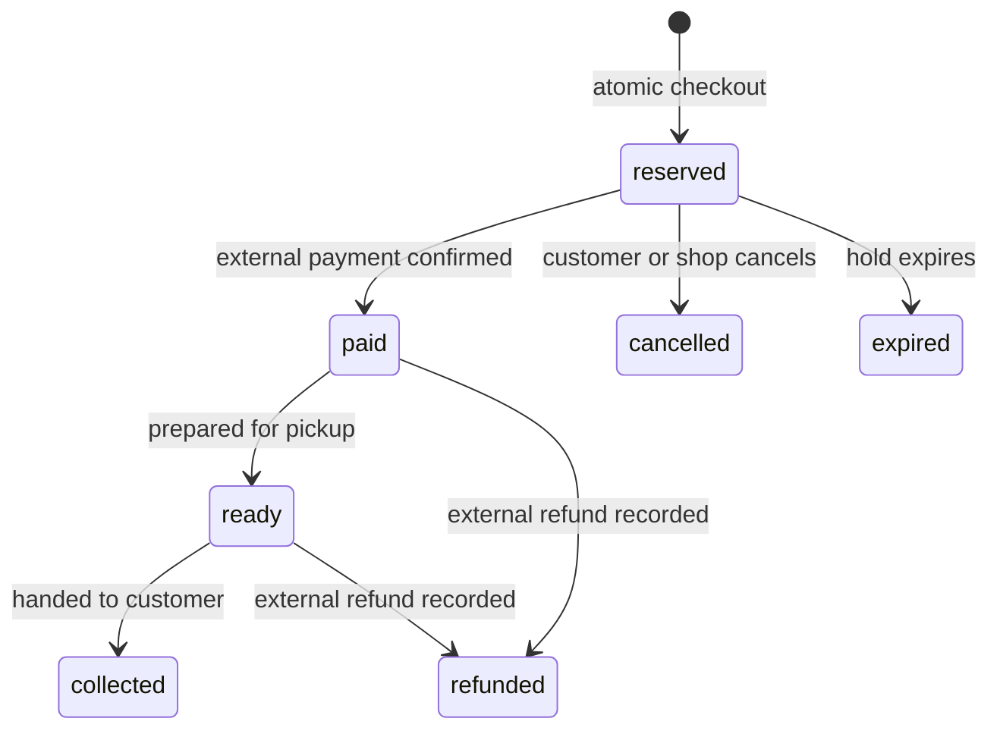
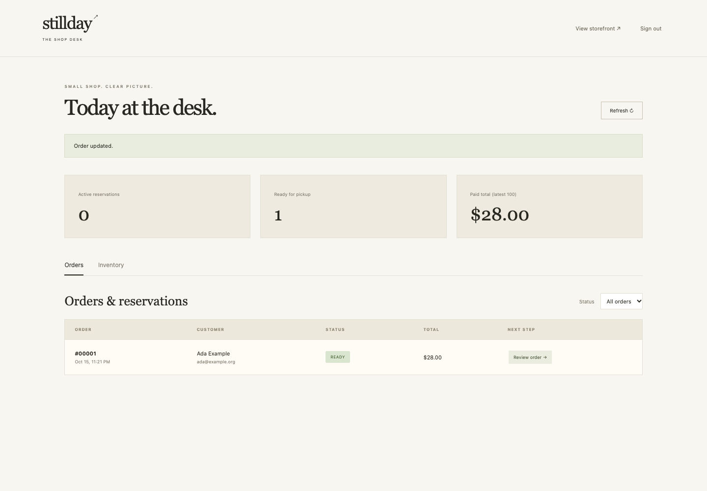

<div align="center">

# Reserve Cart

### A small collection. No accidental overselling.

A self-hosted pickup shop with **expiring stock reservations**,<br>
a private customer order page and a complete shop desk.

[](https://github.com/XingCEO/reserve-cart/actions/workflows/ci.yml)


[](LICENSE)

[Run the shop](#run-the-shop) · [Order lifecycle](#an-explicit-order-lifecycle) · [API](docs/API.md) · [Operating guide](docs/OPERATIONS.md)


</div>

## For small drops and local pickup

Reserve Cart is designed for a small collection with limited quantities: a maker’s drop, a pop-up, a studio shop or a local pickup sale. The interesting part is what happens **after Add to bag**.

| Customer | Shop owner |
| --- | --- |
| Browse, search and filter a responsive collection | Create, edit and archive products |
| Read product details and build a bag | Adjust available stock with a reason |
| Reserve available stock for 30 minutes | Review orders and pickup notes |
| Recover an interrupted checkout with the same request | Record externally confirmed payments |
| Follow an unguessable private order link | Mark orders ready, then collected |
| Cancel an unpaid reservation | Record external refunds and restore stock |

**Stillday is the included fictional demo storefront.** Product illustrations and the hero still life are original SVG assets in the repository, with no external asset service or frontend build dependency. Replace the sample branding and catalog with your own collection.

## Run the shop

Requires Python 3.11+. Install dependencies once while online.

```bash
git clone https://github.com/XingCEO/reserve-cart.git
cd reserve-cart
python3 -m venv .venv
. .venv/bin/activate
python -m pip install .
python -m reserve_cart --demo
```

- Storefront: **http://127.0.0.1:5056**
- Shop desk: **http://127.0.0.1:5056/admin**
- Username: `admin`; the generated password is printed in your terminal.

Demo data is created only for a new database. Restarting preserves products and orders. For an empty shop, set a unique `SHOP_ADMIN_PASSWORD` of at least 12 characters and omit `--demo`. Avoid storing real passwords in shell history or version control.

Try the whole loop: reserve an object in one browser, sign in to the shop desk in another, record a payment reference, mark the order ready and refresh the customer’s private link.

## An explicit order lifecycle



`cancelled`, `expired` and `refunded` restore stock exactly once. `paid`, `ready` and `collected` retain the original deduction. A paid order does not expire. An expired order cannot be marked paid; the shop must handle any late external payment explicitly.

- **Atomic reservations:** SQLite write transactions prevent two customers from buying the last unit.
- **Idempotent checkout:** request keys are scoped to a browser session owner. A retry returns the same order and private link; changing the body under the same key is rejected.
- **Idempotent order actions:** repeated confirmations do not duplicate stock restoration or events.
- **Snapshot prices:** existing orders keep their original product names and prices after catalog edits.
- **Limited contact exposure:** the private customer view omits customer name, email and pickup note. Those appear only in the authenticated shop desk.
- **Private capability links:** the order token is kept in the URL fragment and sent in an Authorization header, keeping it out of ordinary URL access logs. Anyone holding the link can view the order and cancel an unpaid hold; treat it like a password.



## Expiration without a hidden worker

Expired holds are released when the catalog, checkout, order or desk is accessed. The next checkout can therefore reuse expired stock even if no background process was running. For proactive cleanup, run this command using your own scheduler:

```bash
python -m reserve_cart --database /absolute/path/shop.sqlite3 --sweep
```

No scheduler is installed automatically. A browser page does not update itself on expiry; refresh it to retrieve current status and availability. Each browser session can hold at most three active reservations. This is a workflow limit, **not bot protection**: new sessions can evade it.

## Tested workflows

```bash
python -m unittest discover -v

# Optional browser test dependencies
npm ci
npx playwright install chromium
PYTHON=python npm run test:e2e
```

The suite covers last-unit races, atomic multi-line failure, expiration at the exact deadline, idempotent retries, private-link authorization, invalid state transitions, original-price retention, external-refund recording and stock-ledger balance. Chromium tests exercise customer checkout, the separate authenticated shop desk, ready/collected status updates and mobile cancellation. Browser fixtures use a disposable database and synthetic customer data.

README screenshots are generated from these real browser tests. CI runs Python 3.11/3.13 and Chromium.

## Extend the behavior, keep the guarantees

```text
reserve_cart/
  store.py       reservation transactions, inventory ledger and state machine
  __init__.py    sessions, private-link access, admin routes and CSRF
  static/        original SVG art, CSS and plain browser JavaScript
  templates/     storefront and shop desk
```

Use [the API contract](docs/API.md) to build integrations. The bundled [reservation-state review Skill](skills/reservation-state-review/SKILL.md) helps a coding agent reason about race conditions, expiry and event replay before changing the lifecycle. Run the Skill from this checkout; it grants no permission to act on real orders or payments.

## Scope and limits

This is a working **experimental v0.1 pickup storefront**, not a complete payment platform. It does not process cards, move money, send emails, calculate jurisdiction-specific tax, quote shipping, manage customer accounts, support product variants or process returns after collection. Prices are recorded as listed in USD minor units. Payment and refund buttons record an action the shop has already confirmed externally.

The shop desk shows the latest 100 orders; its summary cards cover that same window. Customer contact data and order capability tokens are stored in the database, so protect backups and restrict access. Deploy behind HTTPS with a production WSGI server, add suitable abuse controls, define retention and verify local commerce requirements before real use. See [OPERATIONS.md](docs/OPERATIONS.md).

## Contributing

Bring a small failing scenario: two competing checkouts, an action at the expiry boundary, a replayed refund or a lost browser response. Preserve the state-machine invariants and add a regression test. See [CONTRIBUTING.md](CONTRIBUTING.md).

[MIT](LICENSE) © 2026 XingCEO. Built with Flask and SQLite. Independent implementation; no code or product photography copied from a commercial shop.
